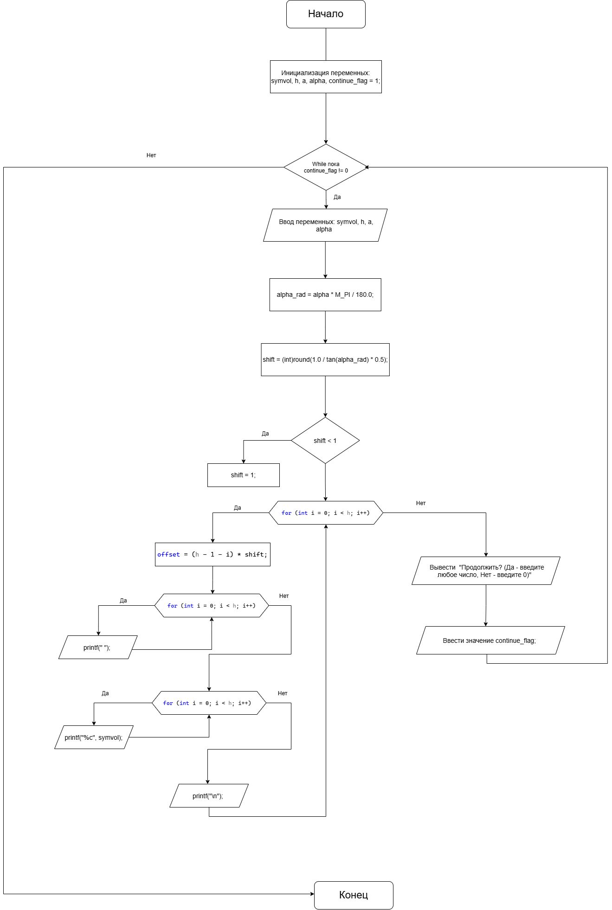
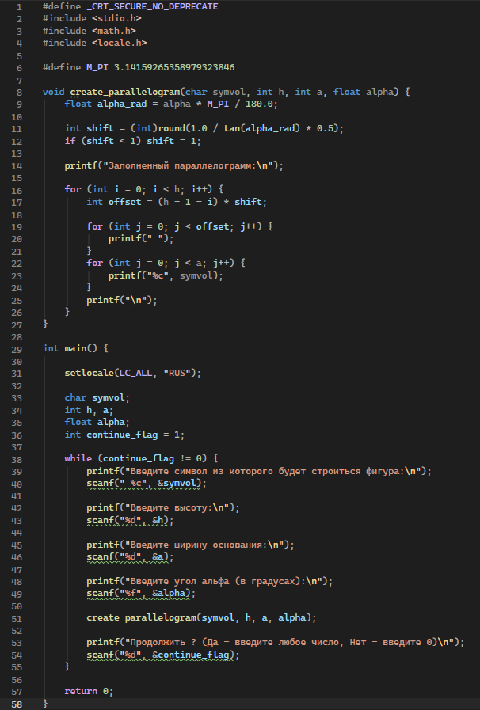
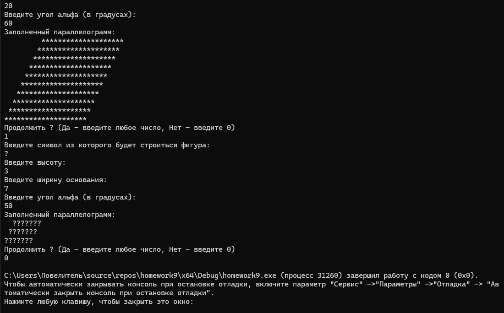

# Домашнее задание к работе 9

## Условие задачи

Написать программу, выводящую на экран заданную геометрическую фигуру, нарисованную с помощью заданного с клавиатуры символа. Предусмотреть возможность изменения размеров фигуры путем задания ее размеров в количестве символов пользователем.

## 1. Алгоритм и блок-схема
### Алгоритм решения
1. **НАЧАЛО**
2. Инициализация переменных: symvol, h, a, alpha, continue_flag = 1;
3. While пока continue_flag != 0:
5. Ввод переменных: symvol, h, a, alpha
6. Перевести угол из градусов в радианы: alpha_rad = alpha * M_PI / 180.0;
7. Вычислить горизонтальное смещение: shift = (int)round(1.0 / tan(alpha_rad) * 0.5);
8. Если shift < 1, то установить shift = 1;
9. for для i от 0 до h-1:
    - Вычислить отступ: offset = (h - 1 - i) * shift
    - for для j от 0 до offset-1:
         - Вывести пробел
    - for для j от 0 до a-1:
         - Вывести символ symvol
10. Вывести запрос "Продолжить? (Да - введите любое число, Нет - введите 0)"
11. Ввести continue_flag
12. **КОНЕЦ**

### Блок-схема

## 2. Реализация программы

## 3. Результаты работы программы

## 4. Информация о разработчике
  **Пелагин Андрей Александрович БИЦТ 262**
